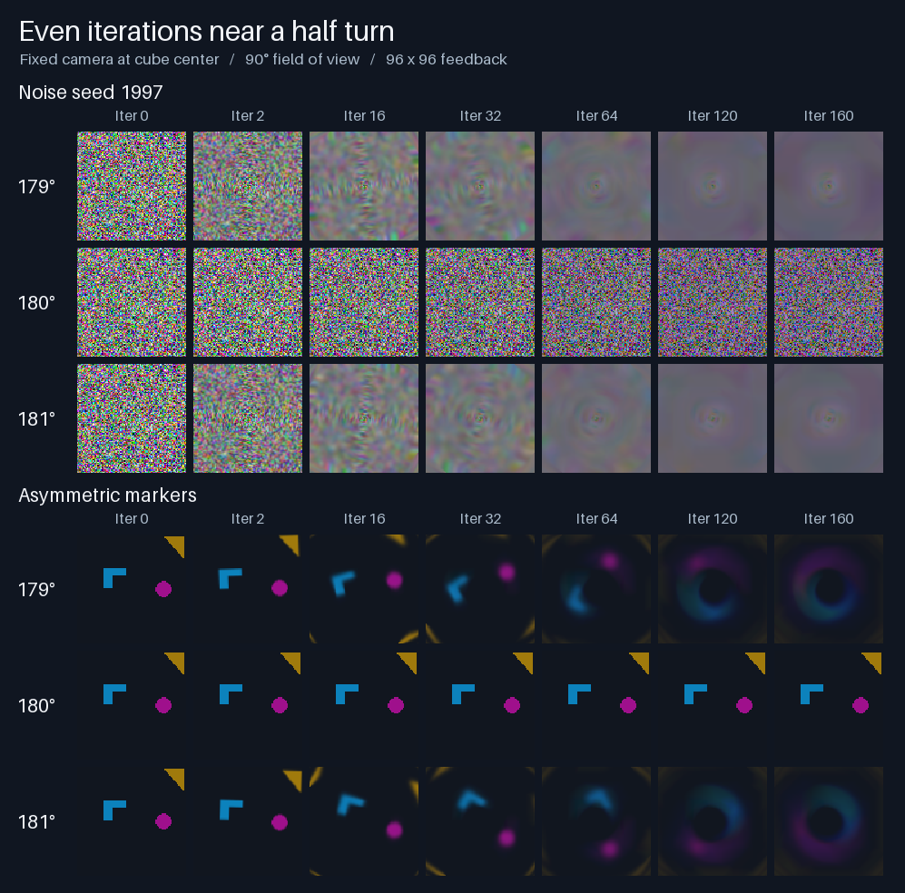

# FractalKaleidoscope

This project is a recreation of a C++ project I made for my SGI workstation back in the summer of 1997 or so using OpenInventor.  This one was quickly whipped together by OpenAI Astra.


## Run the viewer

Open `index.html` directly in a WebGL browser, or run `python -m http.server 8766 --bind 127.0.0.1` in this directory and visit [the local viewer](http://127.0.0.1:8766/index.html). The viewer uses local scripts and has no package dependencies. Orbit, roll, pan, dolly, or press Space to record. Releasing a rotating drag preserves its angular speed. Use **Stop spin** to hold the camera in place while feedback continues.

Use **Start experiment** to keep the current camera and object, initialize both feedback buffers to the default dark color, and stop automatic stepping. **Step 1** and **Step 32** advance the recursion. **Save config** saves the initial conditions and **Save PNG** captures the current feedback image at its native resolution. **Return to live view** restores the interactive camera and starts a fresh feedback texture.

## Program an experiment

Run this in the viewer’s JavaScript console.

```js
const lab = rfLab.experiment;
const config = lab.start({
  width: 320, height: 200, object: 'torus',
  camera: {
    position: [1.12, 0.56, 1.01],
    orientation: [-0.13, 0.4, 0.055, 0.906],
    fovDegrees: 58
  },
  initial: {type: 'noise', seed: 1997}
});
const seed = lab.measurement(); // iteration 0
const rows = lab.step(64);      // iterations 1 through 64, in order
const png = lab.png();          // lossless PNG data URL for iteration 64
lab.start(config);              // replay from the seed
lab.end();                      // return to interactive operation
```

The quaternion is camera-to-world in `[x,y,z,w]` order. The camera looks down local −Z with +Y up. Field of view is vertical, in degrees. `start` returns the resolved configuration including the normalized orientation. Omitted settings default to a 640 × 400 banana scene viewed from [0, 0, 8] with identity orientation. Object choices are `banana`, `torus`, `sphere`, `cube`, and `none`.

Seed options are `{type:"solid",rgb:[5,8,14]}`, `{type:"noise",seed:1997}` with an unsigned 32-bit seed, and `{type:"rgb",base64:"..."}` containing exactly width × height RGB triples in top-to-bottom row order. Feedback is opaque. Iteration zero is the seed itself. Each subsequent iteration renders the room using the previous texture and swaps the two buffers once. The fixed camera ignores mouse input, inertia, and display callbacks. Byte-for-byte repeatability was tested on the same browser and renderer. WebGL arithmetic and rasterization can vary across implementations.

## Run, export, and sweep

For automation, install Node.js 20+ and a local Chrome or Chromium build. Run these commands from the project directory.

```sh
npm ci
npm test
npm run lab -- run --config examples/torus.json --iterations 72 --frames all --out runs/torus
node tools/check-frames.cjs runs/torus
npm run lab -- sweep --config examples/torus.json --iterations 80 --yaw 0,30,60 --elevation=0,20 --distance 1.6,3 --frames 0,40,80 --out runs/grid
```

For a reference period-two orbit, use `examples/half-turn.json` with 162 iterations. A 90-degree square view from the center fills the image with one wall. Rolling the camera 180 degrees reproduces the previous texture upside down on every step. After the shader’s color attenuation settles, iterations 160 and 162 match pixel for pixel on the tested software renderer while iteration 161 differs.

Use a new output directory for each invocation. A run writes `config.json`, `measurements.json` with every iteration including zero, and the requested native PNGs. By default it saves the seed and final images. Replay using the exported config and the iteration count in the report. A sweep visits every combination of yaw, elevation, optical-axis roll (angles in degrees), and distance about the world origin. Use `--roll 0,90,180` to vary the default zero roll. A distance of zero puts the camera at the origin with the specified orientation. It saves each run separately and sorts `ranking.json` by descending score. `--frames` only controls the saved images. All iterations contribute to the metrics.

To encode every iteration, add `--video --fps 24` to a run or sweep. This keeps the complete PNG sequence and writes a lossless RGB FFV1 movie in `sequence.mkv`. Supply FFmpeg on PATH or set `FFMPEG_PATH` to its executable. A run of N iterations includes N+1 movie frames. FFmpeg reports the encoded count in the export. Playback rate only sets movie timestamps.

The interactive Space recorder uses MediaRecorder. Its JSON includes the feedback iteration, capture sample index, and number of successful video-frame requests. The browser may coalesce requests. Its encoded count is reported as `null` because MediaRecorder does not expose it.

### Browser automation

The runner opens the local HTML in a fresh Playwright browser context. By default it uses installed Chrome with ANGLE and SwiftShader. For another Chromium executable, pass `--chromium PATH` or set `CHROMIUM_PATH`. Use `--hardware` to let Chromium choose its usual backend. Each report records the browser version and the WebGL renderer actually reported by the context. [Chromium software rendering documentation](https://chromium.googlesource.com/chromium/src/+/HEAD/docs/gpu/swiftshader.md)

### Measurements and ranking

For each lag from 1 through 32 with available history, the report gives the mean absolute RGB channel difference as a percentage of 255. Each image is sampled on a grid of up to 64 × 40 pixels. Cell `(x,y)` selects the pixel at `floor((x+0.5)*width/gridWidth), floor((y+0.5)*height/gridHeight)` measured from the top left. A zero means the sampled RGB values agree. Fine detail between sample locations can still change.

Diagnoses use the last eight comparisons. A candidate period p must have at least two cycles at the start of that window. Each of its eight errors must be at most 0.5%, and their mean must be below 40% of the lag-one mean. The smallest qualifying period wins. A likely fixed point has a mean difference of at most 0.15% at every lag available throughout the window. Other configurations with a lag-one mean below 2% are labeled slowly evolving. Early diagnoses use the available lags and can change as history accumulates.

The ranking averages three components with equal weight over the final eight observations (or the available tail for shorter runs).

- **Recurrence** rewards a repeat lag that reduces mean error relative to lag one. Its strength is scaled by `min(1, meanLagOnePercent/2)` to suppress tiny fluctuations. It requires eight observations with at least two complete cycles.
- **Complexity** is Shannon entropy of a 32-bin luma histogram, divided by five bits.
- **Spatial structure** measures how much closer adjacent luma values are than two independent draws from the same histogram. Uniform images receive zero. Scores and components are saved alongside the diagnosis so the ranking can be reinterpreted.

### Roll study



At 180° the markers alternate exactly from the seed. At 179° and 181° the magenta disk initially travels in opposite directions, then spreads into an arc. Between iterations 144 and 160, zero rotation falls within 0.01 of the best normalized correlation for both marker runs. The late images leave the rotation speed unresolved.

To reproduce the roll experiment, run `python tools/roll-study.py runs/my-roll-study` with NumPy and Pillow 10.1+ installed alongside the existing Node dependencies. Use a fresh output directory. The study exports every frame through iteration 160, checks exact RGBA recurrence at 90° and 180°, and creates `even-iterations.png` for the 179°, 180°, and 181° runs. The upper panel uses noise seed 1997. The lower panel uses a second shared seed with colored landmarks.

`comparisons.json` records full-image pixel and byte differences. Its interior motion estimate maximizes angular cross-correlation of the noise in an annulus 15–39 pixels from the image center, at 0.25° angular resolution. Positive displacement is clockwise in the exported PNG. The first-step wall comparison uses the projected back-wall boundary and reports the RGB error of a back-wall-only prediction on each side of that boundary.

`period-traces.json` gives the mismatched pixel count and largest absolute RGBA channel difference for **every iteration** of the 90° and 180° noise runs and the 180° marker control. Entries before the first full lag have null differences. The first exact return is indexed by the later frame. Subtract its lag to get the first state on the cycle. For seed 1997 on SwiftShader, frame 122 first matched frame 120 at lag two, and frame 124 first matched frame 120 at lag four.

After red and blue settle in both frames, the lag-`p` mismatch count at iteration `n` equals the number of seed pixels with green above `135 + n - p`. The 39 pixels starting at green 255 needed 120 steps to reach 135. Successive differences in the trace also recover the next three histogram bins. Direct counts in the seed confirmed 31 pixels at 254, 36 at 253, and 30 at 252. [Reference period traces](examples/roll-study/period-traces.json)

To regenerate these measurements from saved frames, run `python tools/roll-study.py --analyze-existing runs/my-roll-study`. The analysis undoes the geometric rotation before checking the green shader prediction against each original seed pixel. For the neighboring rolls, `within0.01OfPeakDegrees` gives the contiguous angular range whose normalized correlation is within 0.01 of the best fit, over the entire indicated frame interval.

### Verification and code layout

`npm test` starts two independent browser processes and compares every decoded pixel of nine frames from a seeded 97 × 61 run. It then exports 41 frames and recomputes each available lag directly from the PNG files, independently of the browser's analysis code. It also checks batch versus single steps, fixed-camera input isolation, top-down RGB seeds, known periods 3 and 32, rendered half- and quarter-turn orbits, slow drift, undamped inertial rotation, and Space recording.

`renderer.js` owns the original meshes and shaders, ping-pong targets, presentation, and native readback. `simulation.js` owns configuration, initialization and the iteration counter. `analysis.js` measures successive images. `viewer.js` connects the UI, live animation, recording and experiment API. The automation and independent PNG verifier live in `tools/`.
